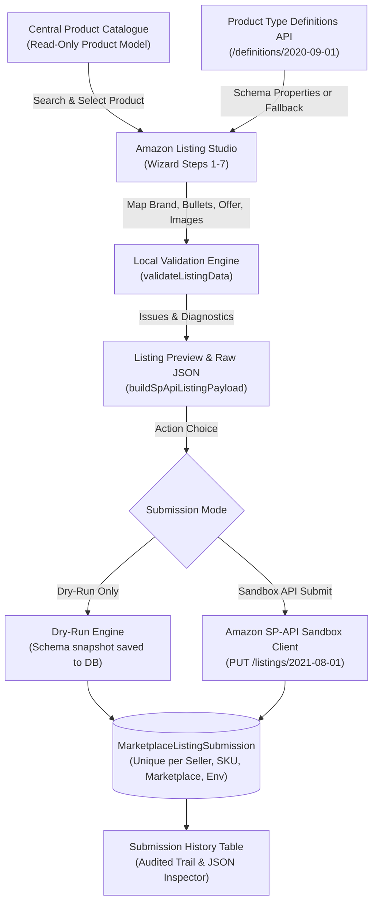

# Task 9 — Amazon Product Listing & Publishing Workflow (Sandbox Only)

**Project:** AI Seller Management Platform  
**Target Marketplace:** Amazon India (`A21TJRUUN4KGV`)  
**SP-API Endpoint Region:** EU (`https://sandbox.sellingpartnerapi-eu.amazon.com`)  
**Status:** Completed & Validated in Strict Sandbox Mode  
**Production Publishing:** STRICTLY DISABLED  

---

## 1. Executive Summary & Objective

Task 9 introduces an end-to-end product listing creation and validation studio to the AI Seller Management Platform. A seller can select an existing product from their central Product Catalogue, map attributes according to Amazon India's official schema specifications, validate requirements, review formatted listing and raw SP-API v2021-08-01 JSON payloads, and execute either a high-fidelity local dry-run or an Amazon SP-API Sandbox submission.

Crucially, **the central master product catalog remains strictly immutable**: master prices and stock quantities are never mutated by Amazon listing configurations. Furthermore, hardcoded backend guards ensure that production publishing cannot be triggered.

---

## 2. Official Amazon SP-API Capabilities vs. Sandbox Realities

| Dimension | Official Amazon Production Capability | Official Amazon SP-API Sandbox Reality | Local Implementation Handling |
| :--- | :--- | :--- | :--- |
| **Product Type Definitions API** | `/definitions/2020-09-01/productTypes` retrieves live JSON Schemas per marketplace for every product type. | The SP-API Sandbox does not reliably return dynamic schema properties for arbitrary Indian product types. | Real endpoint queried first. If unprovisioned or empty, transparently falls back to `DEVELOPMENT_FALLBACK` schemas based on official Amazon India requirements. |
| **Listings Items API v2021-08-01** | `PUT /listings/2021-08-01/items/{sellerId}/{sku}?marketplaceIds=A21TJRUUN4KGV` mutates or provisions listing. | Sandbox supports `mode=VALIDATION_PREVIEW` and returns HTTP 200 with an Amazon submission/issue response, but does not actually create live listings on Amazon.in. | The platform provides two distinct user actions: (1) **High-Fidelity Dry-Run** and (2) **Sandbox SP-API Submission**. It never claims a product is live when in sandbox. |
| **GTIN / Barcode Exemptions** | Amazon Brand Registry grants GTIN exemptions for approved private-label brands. | Sandbox does not perform live brand approval lookups. | If a product has no barcode, the seller checks **Request GTIN Exemption**. The system omits `standard_product_id` and documents the exemption requirement. Fake barcodes are **never** fabricated. |
| **Image Hosting** | Amazon requires public HTTPS image URLs with pure white background for main image. | Sandbox does not download or host images. | Integrates with existing Cloudinary image URLs. Validates HTTPS protocols and formats (JPEG/PNG/WEBP). |

---

## 3. Architecture & Data Flow

---

## 4. Database Schema Design

Model: `MarketplaceListingSubmission` (`backend/src/modules/channels/marketplaceListingSubmission.model.js`)

Key Fields:
- `sellerId`: Tenant ID derived securely from backend authentication.
- `tenantId`: Tenant ID for multi-tenant isolation.
- `channelConnectionId`: Reference to active `ChannelConnection`.
- `productId`: Reference to central catalogue `Product` (never mutated).
- `sellerSku`: Unique Amazon Seller SKU (`AMZ-...`).
- `marketplaceId`: Default `A21TJRUUN4KGV` (Amazon India).
- `productType`: Official product type (e.g., `SHIRT`, `SHOES`, `BAG`, `JEWELRY`, `HOME_BED_AND_BATH`, `CONSUMER_ELECTRONICS`).
- `submissionMode`: Enum `['DRY_RUN', 'SANDBOX_SUBMISSION']`.
- `status`: Enum `['DRAFT', 'VALIDATION_FAILED', 'READY', 'DRY_RUN', 'SUBMITTED', 'ACCEPTED', 'REJECTED', 'ERROR']`.
- `mappedAttributes`: Snapshot of title, brand, description, bullet points, price, quantity, images, and category-specific attributes.
- `payloadPreview`: Official SP-API v2021-08-01 JSON payload snapshot.
- `amazonSubmissionId`: Real or dry-run submission ID returned.
- `issues`: Array of structured validation/API issues (`{ code, severity, message, attribute }`).
- `gtinExemptionRequested`: Boolean flag tracking exemption usage.
- `responseMetadata`: HTTP status, request ID, diagnostics timestamp, and notes.

**Compound Unique Index:**
`{ sellerId: 1, marketplaceId: 1, sellerSku: 1, environment: 1 }` prevents race conditions and accidental duplicate submissions.

---

## 5. Backend REST API Endpoints

All endpoints require verified JWT authentication (`authMiddleware`), tenant attachment (`tenantMiddleware`), and seller authorization (`authorizeRoles('seller', 'admin')`).

| Method | Endpoint | Description |
| :--- | :--- | :--- |
| `GET` | `/api/channels/amazon/products/eligible` | Search eligible central catalogue products scoped to the authenticated tenant. |
| `GET` | `/api/channels/amazon/definitions/product-types` | Search official/fallback Amazon product types for Amazon India. |
| `GET` | `/api/channels/amazon/definitions/product-types/:productType` | Retrieve JSON Schema definition for a specific product type. |
| `POST` | `/api/channels/amazon/listings/submissions/validate` | Validate mapped attributes and image links against SP-API constraints without saving. |
| `POST` | `/api/channels/amazon/listings/submissions` | Create or update draft listing submission record. |
| `POST` | `/api/channels/amazon/listings/submissions/:id/submit` | Execute either a high-fidelity dry run or official SP-API Sandbox submission. |
| `GET` | `/api/channels/amazon/listings/submissions` | List all historical listing submissions for the authenticated seller. |
| `GET` | `/api/channels/amazon/listings/submissions/:id` | Retrieve submission details and payload snapshot by ID. |

---

## 6. Frontend Components

1. **`AmazonListingPublisher.jsx`**:
   - Integrated as a primary tab (`"Publish Listing (Sandbox)"`) and header action (`"Create Amazon Listing"`) in `AmazonChannel.jsx`.
   - **Step 1: Select Product**: Live search across central catalogue items; displays stock, master price, SKU, and thumbnail.
   - **Step 2: Product Type**: Auto-suggests based on category; displays retrieved schema requirements.
   - **Step 3: Attribute Mapping**: Title, brand, description, dynamic bullet points (3–5), category attributes, and GTIN / Exemption toggle.
   - **Step 4: Image Handling**: Validates Cloudinary image assets, enforces HTTPS, and provides instant previews.
   - **Step 5: Offer & Pricing**: Channels-specific price and stock allocation, guaranteeing that master product price/stock are never mutated.
   - **Step 6: Validation & Preview**: Real-time error/warning diagnostics, interactive Amazon listing mockup card, and raw SP-API JSON payload preview.
   - **Step 7: Submission**: Dual buttons for **Execute Dry-Run** and **Submit to Sandbox**.
   - **Submissions History**: Tabular view of all historical listing submissions with status badges (`DRY_RUN`, `SUBMITTED`, `ACCEPTED`, `VALIDATION_FAILED`) and modal payload viewer.

---

## 7. Security & Production Safety Controls

1. **Hardcoded Production Publishing Guard**:
   `executeListingSubmission` evaluates runtime environment. If `activeEnv === 'production'`, it immediately throws `PRODUCTION_PUBLISHING_DISABLED` (HTTP 403).
2. **Tenant Isolation**:
   Every query filters strictly by authenticated `sellerId`/`tenantId`. Cross-tenant product selection and cross-tenant submission lookups are rejected.
3. **No Credential Exposure**:
   LWA refresh tokens, client secrets, and AES-256-GCM encryption keys are completely stripped from API responses and sanitized in diagnostic logs.
4. **Catalogue Data Immutability**:
   Listing creation reads from the `Product` model but never executes updates on `Product.stock` or `Product.masterPrice`.
5. **No Fake Data or ASINs**:
   The platform never invents fake barcodes (UPC/EAN) or claims a listing is live when in dry-run/sandbox mode.

---

## 8. Automated Test Results

### Task 9 Comprehensive Test Suite (`test_amazon_task9.js`)
* **Total Tests Executed:** 15
* **Passed:** 15
* **Failed:** 0
* **Coverage:**
  1. Product selection mapping
  2. Product ownership / cross-tenant protection
  3. Tenant isolation in submissions model
  4. Product type definitions and development fallback schemas
  5. Missing required attribute rejection
  6. Missing GTIN rejection vs. legitimate exemption allowance
  7. HTTPS image URL validation
  8. SP-API v2021-08-01 payload structure compliance
  9. Catalogue stock & master price immutability
  10. Duplicate submission prevention & compound index
  11. High-fidelity dry run execution
  12. Sandbox execution handling
  13. Validation and error preservation
  14. Strict production publishing rejection
  15. Scoped submission history retrieval
  16. Unauthorized submission access denial

### Full Platform Regression Verification
* **`test_google_auth_hardening.js`**: 13/13 PASSED (0 failed)
* **`test_auth_hardening.js`**: 17/17 PASSED (0 failed)
* **`test_amazon_connection.js`**: 16/16 PASSED (0 failed)
* **`test_amazon_orders.js`**: 18/18 PASSED (0 failed)
* **`test_amazon_inventory_pricing.js`**: 16/16 PASSED (0 failed)
* **`test_amazon_sync.js`**: 7/7 PASSED (0 failed)
* **`test_amazon_task7.js`**: 14/14 PASSED (0 failed)
* **Frontend Production Build (`npm run build`)**: PASSED (`built in 14.21s`, 0 errors)
